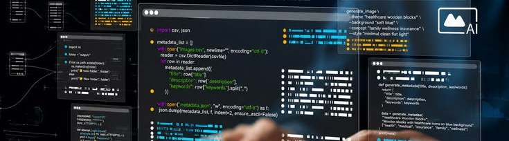

<!-- Banner -->
<p align="center">
  
</p>

<h1 align="center">Anas Abdiwahid Hussein Warsame</h1>
<p align="center"><b>Full-Stack Software Developer &nbsp;|&nbsp; UI/UX Designer &nbsp;|&nbsp; IoT &amp; Arduino &nbsp;|&nbsp; Multimedia</b></p>

<p align="center">
  <a href="https://anazabdiwahid.netlify.app/">
    
  </a>
</p>

<p align="center">
  
  
  
</p>

##  About Me

<table>
<tr>
<td width="36%" valign="top" align="center">


<h3>Anas Abdiwahid</h3>
<sub> Mogadishu, Somalia</sub>
<br />
<sub> Hormuud University — Computer Science</sub>
<br /><br />


<br /><br />


</td>
<td width="64%" valign="top">

```javascript
const anas = {
    name:       "Anas Abdiwahid Hussein Warsame",
    title:      "Full-Stack Software Developer & UI/UX Designer",
    location:   "Mogadishu, Somalia",
    education:  "Computer Science (4th year) — Hormuud University",
    experience: "4+ years • 99+ projects • 99+ happy clients",

    specialties: [
        "Full-stack web development",
        "IoT & Arduino systems",
        "Creative multimedia solutions",
    ],

    skills: [
        "HTML & CSS", "JavaScript", "PHP & MySQL", "React.js",
        "Python", "Flutter", "C / C++ / C#", "IoT & Arduino",
    ],

    currentlyBuilding: "SIMDA — Sharia-compliant microfinance platform",
    respondsWithin:    "24 hours",
};
```

> *"Build tools people actually use — then make them simple."*

</td>
</tr>
</table>

##  Connect With Me

<p align="center">
  <a href="https://anazabdiwahid.netlify.app/"></a>
  <a href="https://www.linkedin.com/in/anas-abdiwahid-472738262"></a>
  <a href="mailto:anasabdiwahidhussein@gmail.com"></a>
  <a href="https://wa.me/252616256534"></a>
  <br />
  <a href="https://www.instagram.com/anas_abdiwahid1"></a>
  <a href="https://www.facebook.com/share/1AjmvAjtgZ/"></a>
  <a href="https://www.tiktok.com/@anas_abdiwahid"></a>
  <a href="https://github.com/anasabdiwahid"></a>
</p>

##  Tech Stack

<p align="center">
  <a href="https://skillicons.dev">
    
    <br />
    
  </a>
</p>

<p align="center">
  
  
  
  
  
  
</p>

##  What I Do

<table>
  <tr>
    <td width="33%" valign="top">
      <h4> Full-Stack Web Development</h4>
      Complete, responsive web apps and management systems from database to interface.
    </td>
    <td width="33%" valign="top">
      <h4> UI/UX Design</h4>
      Clean dashboards and interfaces designed around how people actually work.
    </td>
    <td width="33%" valign="top">
      <h4> Logo &amp; Visual Branding</h4>
      Logos and brand identities that make businesses recognisable.
    </td>
  </tr>
  <tr>
    <td width="33%" valign="top">
      <h4> Multimedia Production</h4>
      Graphics, posters, video editing and social media assets.
    </td>
    <td width="33%" valign="top">
      <h4> IT &amp; IoT Systems</h4>
      Hardware–software integration, server setup, troubleshooting and smart automation.
    </td>
    <td width="33%" valign="top">
      <h4> Responsive Web Apps</h4>
      Fast, mobile-first apps that work on every screen, installable as PWAs.
    </td>
  </tr>
</table>

##  Featured Projects

<table>
  <tr>
    <td width="50%" valign="top">
      <h3> <a href="https://github.com/anasabdiwahid/SIMDA">SIMDA</a></h3>
      <p>Somali Islamic Microfinance Development Association — Sharia-compliant loans and Murabaha, Branch Manager approvals, repayments with emailed receipts, credit scores and PAR30.</p>
       
    </td>
    <td width="50%" valign="top">
      <h3> <a href="https://sobda.org/">SOBDA</a></h3>
      <p>Somali Blood Donation Association — live health-tech system connecting donors with people in need.</p>
       
    </td>
  </tr>
  <tr>
    <td width="50%" valign="top">
      <h3> <a href="https://github.com/anasabdiwahid/AN-Chat">A/N Chat</a></h3>
      <p>Real-time messaging with voice and video calling — PHP, MySQL, WebSockets and WebRTC, installable as a PWA.</p>
       
    </td>
    <td width="50%" valign="top">
      <h3> 4 SEASON Restaurant POS</h3>
      <p>Full-stack point-of-sale system for a local restaurant — orders, menu and sales.</p>
       
    </td>
  </tr>
  <tr>
    <td width="50%" valign="top">
      <h3> <a href="https://github.com/anasabdiwahid/HomeHub-Property-Management">HomeHub</a></h3>
      <p>Property management system for Mogadishu, Somalia — PHP 8, MySQL and Bootstrap.</p>
       
    </td>
    <td width="50%" valign="top">
      <h3> Suuq Furan Platform</h3>
      <p>Local web app for a store — products, customers and sales in one place.</p>
       
    </td>
  </tr>
  <tr>
    <td width="50%" valign="top">
      <h3> <a href="https://github.com/anasabdiwahid/Php-Attendance">Smart Exam Attendance</a></h3>
      <p>Examination attendance management — PHP, MySQL and Tailwind CSS.</p>
       
    </td>
    <td width="50%" valign="top">
      <h3> Analytics Dashboard</h3>
      <p>UI/UX admin dashboard for tracking business metrics at a glance.</p>
       
    </td>
  </tr>
  <tr>
    <td width="50%" valign="top">
      <h3> <a href="https://github.com/anasabdiwahid/Maraayn-Management-System">Maraayn Management System</a></h3>
      <p>Management system built with TypeScript.</p>
      
    </td>
    <td width="50%" valign="top">
      <h3> <a href="https://github.com/anasabdiwahid/BARWAQO-BANK">Barwaqo Bank</a></h3>
      <p>Banking web application built with JavaScript.</p>
      
    </td>
  </tr>
</table>

##  IoT &amp; Embedded Hardware

| Project | What it does | Hardware |
|---|---|---|
| **Smart Sensor System** | Ultrasonic distance sensing with buzzer alerts | Arduino Uno, C++ firmware |
| **Automated Robotic Actuator Unit** | Motor and servo control | ESP32 / Arduino, L298N driver |
| **Connected IoT Monitor** | Live telemetry from PIR and IR sensors to the cloud | ESP32, IoT cloud |

##  Posters &amp; Media

| Work | For |
|---|---|
| [How AI Identifies You](https://www.facebook.com/share/p/1J4Hjv9Kbj/) | AI Training Week — NextOne |
| [Data Storytelling with AI](https://www.facebook.com/share/p/1AaMe42rQN/) | UNICEF &amp; ASPAIRC campaign |
| [AI Ethics &amp; Public Sector](https://www.facebook.com/share/p/1DefjYuNSw/) | UNESCO SPARK-AI |
| Coffee for Friday | Commercial branding poster |
| Video Editing Showcase | Motion graphics — Premiere Pro |

##  Certificates

<sub>National Training Week, 2026</sub>

- **Mastering Prompt Engineering** — Aug 29
- **AI for Health Awareness &amp; Disease Prevention** — Sep 1
- **Navigating AI-Generated Media with AI Tools** — Sep 2
- **From Graduation to Employment: AI Career Bridge** — Sep 2
- **UNESCO: AI Ethics &amp; Public Sector Capacity** — Sep 2

##  Collaborations

<p align="center">
  <a href="https://ntw.hu.edu.so/"></a>
  <a href="https://sobda.org/"></a>
  <a href="https://buugtabiye.netlify.app/"></a>
  <a href="https://www.hornai.org/"></a>
</p>

##  GitHub Analytics

<p align="center">
  
</p>

<p align="center">
  
  
</p>

<p align="center">
  
</p>

##  GitHub Trophies

<p align="center">
  
</p>
